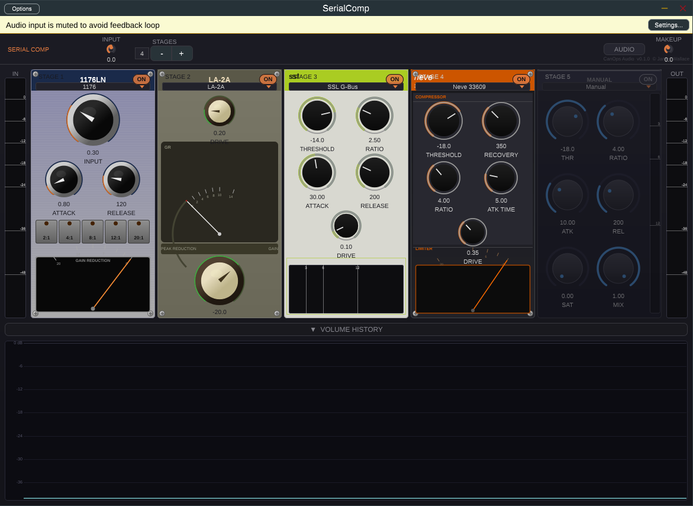
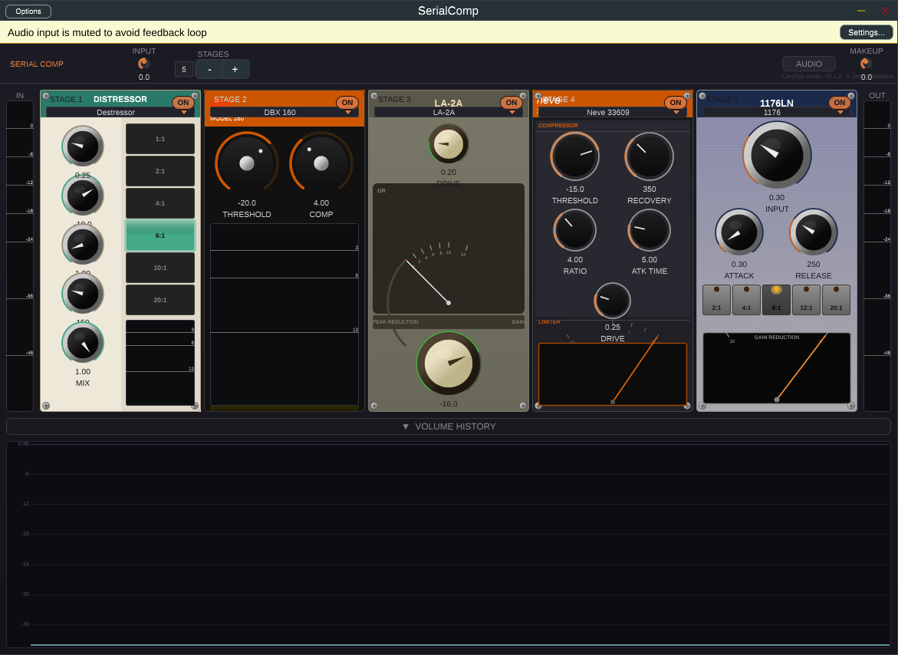

# SerialComp

A multi-stage serial compressor plugin (VST3, AU and Standalone) built with [JUCE](https://juce.com).
Chain up to five compressor stages in series, and give each stage the character of a classic hardware unit.
Several gentle stages often sound more transparent than one stage working hard, and each stage can have a different personality.



## Features

- **1–5 stages in series**, each with its own model, threshold, ratio, attack, release, saturation and dry/wet mix.
- **Six hardware-inspired models plus a Manual mode**, each with its own detector behaviour, knee and saturation curve, and a UI laid out like the unit it is modelled on.
- **Input saturation** per stage, run at 2× oversampling to keep aliasing out of the signal.
- **Global input and makeup gain**, ramped to avoid zipper noise.
- **Metering:** input/output level meters, a gain-reduction meter on every stage, and a 20-second volume-history display that overlays the level after each stage.
- Parallel (New York style) compression through the per-stage **Mix** control.



## Models

| Model | Detector | Knee | Saturation character |
|---|---|---|---|
| **1176** | Peak, fast | Hard | FET: strong drive with asymmetric (even-harmonic) bias |
| **LA-2A** | Peak blended 60/40 with a slow (80 ms / 2.5 s) optical-style path | Very soft (6 dB) | Tube/opto: soft arctangent curve |
| **Destressor** | Peak | 2 dB | Versatile FET-style drive with a little asymmetry |
| **DBX 160** | RMS-like (power domain) | Hard | Clean VCA, gentle soft limiting |
| **Neve 33609** | Peak | 3 dB | Transformer: heavy, clearly asymmetric |
| **SSL G-Bus** | Peak blended 70/30 with the slow path (auto-release) | 2 dB | VCA bus: light warmth |
| **Manual** | Peak | 2 dB | Neutral, no saturation by default |

Selecting a model changes the detector, knee and saturation curve. The threshold, ratio, attack and release you set are yours.

## Controls

**Per stage**

| Control | Range | Notes |
|---|---|---|
| Model | 7 choices | See the table above |
| Threshold | −60 … 0 dB | |
| Ratio | 1:1 … 40:1 | Hardware models expose their own button sets on the panel |
| Attack | 0.01 … 200 ms | |
| Release | 5 … 5000 ms | |
| Saturation (Sat / Drive) | 0 … 1 | Peak-normalised, so it adds colour without peaks exceeding full scale |
| Mix | 0 … 1 | Dry/wet blend for parallel compression |
| On | on/off | Toggling is faded, so there are no clicks |

**Global:** Input gain (−18 … +18 dB), Makeup gain (−18 … +24 dB), Stages (1 … 5).

### Signal flow

```
input gain → [stage 1] → [stage 2] → … → [stage N] → makeup gain → output
                 └ saturation (2× oversampled) → detector → gain computer → gain → dry/wet mix
```

## Installing a release

Download the build for your platform from the [Releases](../../releases) page and copy it to your plugin folder:

| Platform | Format | Location |
|---|---|---|
| Windows | VST3 | `C:\Program Files\Common Files\VST3` |
| macOS | VST3 | `/Library/Audio/Plug-Ins/VST3` or `~/Library/Audio/Plug-Ins/VST3` |
| macOS | AU | `~/Library/Audio/Plug-Ins/Components` |
| Linux | VST3 | `~/.vst3` |

Rescan plugins in your DAW. SerialComp appears under *Fx → Dynamics*. The Standalone app can be run directly, and its **Audio** button opens the sample-rate, bit-depth and buffer-size settings.

## Building from source

Requirements: CMake ≥ 3.22, a C++17 compiler, and Git. JUCE 7.0.12 is downloaded automatically through CMake's `FetchContent`.

```bash
git clone https://github.com/adrianoftyriel/SerialComp.git
cd SerialComp
cmake -B build -DCMAKE_BUILD_TYPE=Release
cmake --build build --config Release -j
```

Build artefacts are placed under `build/SerialComp_artefacts/<config>/` (`VST3/`, `AU/` on macOS, `Standalone/`).
You can build one format with `--target SerialComp_VST3`, `SerialComp_AU` or `SerialComp_Standalone`.

Platform notes:

- **Windows:** Visual Studio 2022 (MSVC). Use `cmake -B build -G "Visual Studio 17 2022"`.
- **macOS:** Xcode command-line tools. The deployment target is 10.13. `-G Xcode` also works.
- **Linux:** install the JUCE dependencies first. On Debian/Ubuntu:
  ```bash
  sudo apt install build-essential cmake git libasound2-dev libfreetype-dev libfontconfig1-dev \
       libx11-dev libxcomposite-dev libxcursor-dev libxext-dev libxinerama-dev libxrandr-dev \
       libxrender-dev libgl-dev
  ```

## Project layout

| File | Purpose |
|---|---|
| `Source/PluginProcessor.*` | Parameters, state, global gain, metering, stage chain |
| `Source/CompressorStage.*` | One compressor stage: saturation, detector, gain computer, mix |
| `Source/CompressorModels.h` | Model enum, names, defaults and colours |
| `Source/PluginEditor.*`, `Source/StageComponent.*` | Editor and the per-model hardware-style panels |
| `Source/CustomLookAndFeel.*` | Knob and control drawing |
| `Source/LevelMeter.h`, `Source/GainReductionMeter.h`, `Source/WaveformDisplay.h` | Meters and the volume-history display |

## Notes on the DSP

- Detectors work on a dB-domain envelope with separate attack and release coefficients. The detector is stereo-linked (the louder channel drives both).
- Saturation is `f(drive·x + bias) − f(bias)` with `f = tanh` (or `atan` for the LA-2A), scaled so peaks never exceed ±1. The bias creates even-order harmonics and is followed by a 5 Hz DC blocker. Both amounts scale with the Sat control, so the curve fades smoothly to unity as Sat approaches 0.
- The saturator runs at 2× oversampling (polyphase IIR half-band filters). This adds a few samples of latency to the wet path of a stage that has saturation engaged. The plugin does not report latency to the host.
- The audio thread does no allocation and takes no locks. Parameters are read through cached atomic pointers.

## Licence

No licence has been chosen yet. All rights reserved by the author until one is added.
